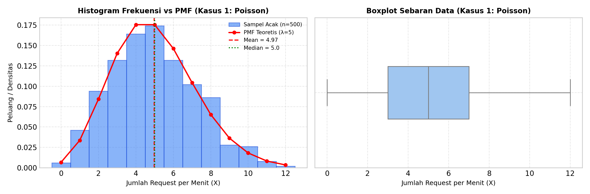
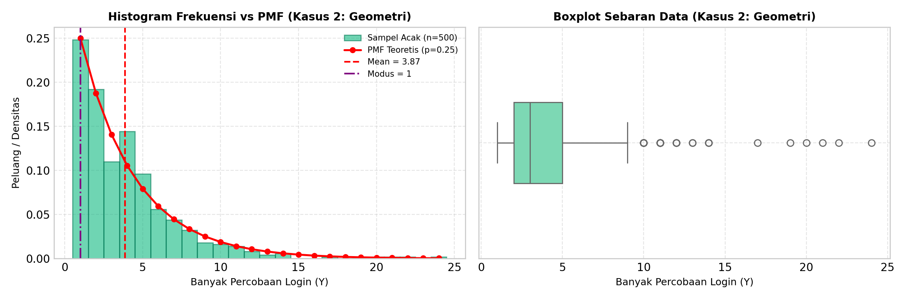

# LAPORAN TUGAS INDIVIDU STATISTIKA & PROBABILITAS
## ANALISIS 2 STUDI KASUS DISTRIBUSI DISKRIT PADA SISTEM INFORMASI
### (DISTRIBUSI POISSON DAN DISTRIBUSI GEOMETRI)

Mata Kuliah     : Statistika & Probabilitas
Dosen Pengampu  : Dr. Wiyli Yustanti, S.Si., M.Kom.
Nama Mahasiswa  : HENDRA CAHYO SETIAWAN
NIM             : 26051905039
Program Studi   : S2 Informatika, Fakultas Teknik, UNESA
Tahun Akademik  : Gasal 2026/2027

---

### SOAL / INSTRUKSI TUGAS:
Carilah 2 studi kasus bidang sistem informasi/informatika yang memiliki karakteristik berdistribusi diskrit, misalnya geometri, binomial negative, hypergeometri atau poisson. Pilih dua jenis distribusi diskrit yang berbeda (kecuali Bernoulli/ Binomial). Lakukan kegiatan sebagai berikut :
1. Bangkitkan datanya secara acak dari distribusi tersebut dengan n > 100
2. Hitung statistik deskriptifnya meliputi mean, modus, median, presentil 25 dan 75, varians, skewness dan kurtosisnya.
3. Interpetasikan hasil melalui nilai statistik deskriptif yang diperoleh dengan analisis yang jelas.
4. Kumpulkan laporan sesuai deadline dan format laporan seperti tugas individu sebelumnya (pdf)
5. Kumpulkan file ekperimen ( notebook python/R )

---

### PENGERJAAN TUGAS:

#### 1. Pemilihan Dua Studi Kasus di Bidang Sistem Informasi

* **Studi Kasus 1: Distribusi Poisson (Kedatangan Request ke Web Server Sistem Informasi per Menit)**
  Pada sistem informasi berbasis web, beban server diukur dari banyaknya request halaman yang masuk setiap satuan waktu. Dalam studi kasus ini, variabel acak X menyatakan banyaknya request yang diterima oleh server dalam selang waktu 1 menit pada jam kerja aktif. Kasus ini cocok dimodelkan dengan distribusi Poisson karena request datang secara acak dan independen satu sama lain dalam rentang waktu kontinu dengan laju kedatangan rata-rata tetap, yaitu ditentukan parameter lambda = 5 request per menit.

* **Studi Kasus 2: Distribusi Geometri (Percobaan Login Pengguna ke Portal Sistem Informasi hingga Berhasil)**
  Pada saat pengguna mencoba masuk ke portal sistem informasi, ada kemungkinan login gagal di awal (misalnya salah ketik password atau captcha keliru) sebelum akhirnya berhasil masuk. Variabel acak Y menyatakan jumlah percobaan login yang dilakukan pengguna sampai login pertama kali berhasil. Karakteristik ini mengikuti distribusi geometri karena menggambarkan proses percobaan independen berulang sampai menemukan keberhasilan pertama (sukses/gagal). Pada kasus ini ditentukan peluang berhasil login pada setiap percobaan adalah p = 0.25 (25%).

---

#### 2. Pembangkitan Data Acak (n = 500)

Untuk memenuhi syarat n > 100, data dibangkitkan sebanyak 500 sampel menggunakan fungsi acak di Python (library `numpy`) dengan menetapkan `seed(42)` agar hasil simulasi konsisten dan dapat direplikasi:
* **Kasus 1 (Poisson)**: `data_poisson = np.random.poisson(lam=5, size=500)`
* **Kasus 2 (Geometri)**: `data_geometric = np.random.geometric(p=0.25, size=500)`

---

#### 3. Hasil Perhitungan 8 Statistik Deskriptif

Berikut adalah hasil perhitungan 8 parameter statistik deskriptif dari data acak 500 sampel:

**A. Kasus 1: Distribusi Poisson (lambda = 5, n = 500 data)**
* Ukuran data (n) : 500 data
* Mean (Rata-rata) : 4.9740 (nilai teoretis E(X) = 5.0000)
* Modus : 5 (paling sering muncul, sebanyak 87 kali)
* Median (Q2) : 5.0
* Persentil 25 (Q1) : 3.0
* Persentil 75 (Q3) : 7.0 (rentang interkuartil / IQR = 4.0)
* Varians sampel (s²) : 5.2318 (nilai teoretis Var(X) = 5.0000)
* Standar deviasi (s) : 2.2873
* Kemencengan (Skewness) : 0.3095
* Keruncingan (Kurtosis) : -0.3099

**B. Kasus 2: Distribusi Geometri (p = 0.25, n = 500 data)**
* Ukuran data (n) : 500 data
* Mean (Rata-rata) : 3.8720 (nilai teoretis E(Y) = 4.0000)
* Modus : 1 (paling sering muncul, sebanyak 124 kali / 24.8%)
* Median (Q2) : 3.0
* Persentil 25 (Q1) : 2.0
* Persentil 75 (Q3) : 5.0 (rentang interkuartil / IQR = 3.0)
* Varians sampel (s²) : 10.8173 (nilai teoretis Var(Y) = 12.0000)
* Standar deviasi (s) : 3.2890
* Kemencengan (Skewness) : 2.2602
* Keruncingan (Kurtosis) : 7.7888

---

#### 4. Visualisasi Grafik (Histogram & Boxplot)

Grafik di bawah ini menampilkan perbandingan histogram data hasil simulasi dengan kurva peluang teoretisnya (PMF), serta diagram boxplot untuk melihat sebaran data dan letak titik pencilan (outlier):

##### A. Grafik Kasus 1: Distribusi Poisson (Kedatangan Request Web Server)

*Gambar 1: Histogram frekuensi vs kurva PMF Poisson (kiri) dan boxplot sebaran data (kanan).*

##### B. Grafik Kasus 2: Distribusi Geometri (Percobaan Login Pengguna)

*Gambar 2: Histogram frekuensi vs kurva PMF Geometri (kiri) dan boxplot sebaran data (kanan).*

---

#### 5. Interpretasi Hasil Statistik Deskriptif

##### A. Kasus 1: Distribusi Poisson (Request Web Server Sistem Informasi)
Dari 500 menit data simulasi yang diambil, diperoleh rata-rata (mean) kedatangan request sebesar 4.97 request per menit dengan nilai tengah (median) di angka 5.0. Nilai mean dan median yang sangat berdekatan ini menunjukkan bahwa data request terpusat cukup seimbang di tengah. Beban request yang paling sering dialami server per menit adalah 5 request (modus = 5), yang tercatat terjadi sebanyak 87 kali selama masa pengamatan.

Sebaran data tengah yang diukur melalui persentil 25 (Q1 = 3.0) dan persentil 75 (Q3 = 7.0) memperlihatkan bahwa pada separuh waktu pengamatan, server menangani antara 3 sampai 7 request tiap menitnya (rentang IQR = 4.0). Fluktuasi beban server tergolong stabil dan wajar dengan standar deviasi 2.29 dan varians 5.23. Nilai varians sampel ini sangat dekat dengan nilai rata-ratanya (4.97), yang membuktikan karakteristik utama distribusi Poisson di mana nilai varians sama dengan nilai rata-ratanya (Var(X) = E(X) = lambda).

Bentuk kurva sebaran memiliki nilai kemencengan (skewness) positif kecil (0.31) dan keruncingan (kurtosis) sebesar -0.31. Nilai kurtosis yang mendekati nol menunjukkan bentuk puncak kurva menyerupai kurva lonceng distribusi normal. Nilai skewness positif tipis terjadi karena sesekali ada lonjakan singkat sampai 10–12 request pada menit-menit tertentu, namun secara keseluruhan beban server relatif stabil di kisaran 5 request per menit.

##### B. Kasus 2: Distribusi Geometri (Percobaan Login Pengguna Sistem Informasi)
Pada kasus login pengguna, angka yang paling banyak muncul adalah 1 (modus = 1), di mana sebanyak 124 pengguna (sekitar 24.8% dari total sampel) langsung berhasil login pada percobaan pertama. Hal ini wajar karena peluang berhasil per percobaan sudah ditetapkan sebesar 25%. Sementara itu, nilai median berada di angka 3.0, yang berarti 50% pengguna sudah berhasil masuk ke sistem dalam 3 kali percobaan atau kurang.

Rata-rata (mean) percobaan yang dibutuhkan pengguna adalah 3.87 kali percobaan, sangat dekat dengan nilai harapan teoretisnya (1/p = 4 kali). Nilai rata-rata ini lebih besar dari median karena dipengaruhi oleh sebagian kecil pengguna yang butuh mencoba berkali-kali hingga berhasil, sehingga menarik nilai mean ke arah kanan. Dari persentil 25 (Q1 = 2.0) dan persentil 75 (Q3 = 5.0), tampak bahwa 75% pengguna sudah berhasil login paling lambat pada percobaan ke-5.

Variabilitas data pada kasus ini cukup tinggi, terlihat dari nilai varians sebesar 10.82 dan standar deviasi 3.29. Hal ini menggambarkan keragaman pengalaman login pengguna: sebagian besar pengguna berhasil dalam 1–4 kali percobaan, namun ada juga pengguna yang baru berhasil setelah belasan kali mencoba. Kondisi ini tercermin jelas dari nilai kemencengan (skewness) yang sangat tinggi (2.26) dan kurtosis ekses sebesar 7.79. Kurva datanya memiliki puncak yang sangat tajam di angka 1 dan ekor yang memanjang jauh ke kanan akibat adanya beberapa pengguna dengan jumlah percobaan login yang tinggi.

---

#### 6. Kesimpulan

1. Pemodelan kedatangan request web server dengan distribusi Poisson (lambda = 5) dan percobaan login pengguna dengan distribusi geometri (p = 0.25) berhasil disimulasikan secara acak pada 500 data.
2. Hasil kalkulasi statistik deskriptif dari data sampel terbukti sangat mendekati ekspektasi teoretis masing-masing distribusi.
3. Pada distribusi Poisson, rata-rata dan varians sampel bernilai hampir seimbang (~5) dengan sebaran data yang terpusat dan mendekati bentuk simetris lonceng normal.
4. Pada distribusi geometri, mayoritas pengguna langsung sukses pada percobaan awal (modus = 1), namun sebaran datanya memiliki variabilitas tinggi dan berekor panjang ke kanan akibat adanya proses pengulangan hingga sukses pertama.
