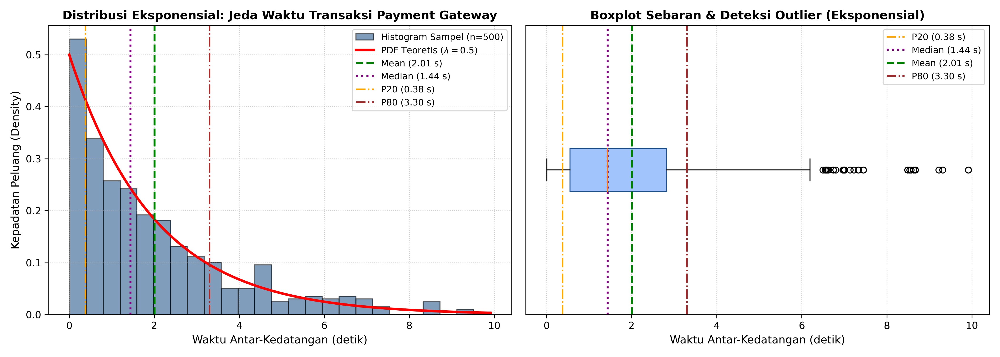
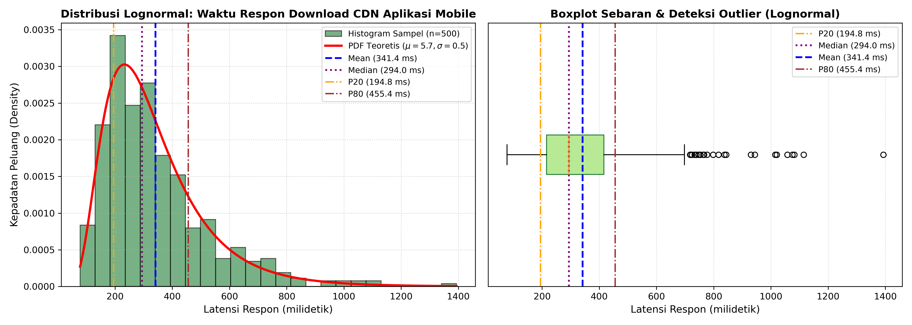

# LAPORAN TUGAS INDIVIDU STATISTIKA & PROBABILITAS
## ANALISIS 2 STUDI KASUS DISTRIBUSI KONTINU PADA SISTEM INFORMASI
### (DISTRIBUSI EKSPONENSIAL DAN DISTRIBUSI LOGNORMAL)

- **Mata Kuliah**     : Statistika & Probabilitas
- **Dosen Pengampu**  : Dr. Wiyli Yustanti, S.Si., M.Kom.
- **Nama Mahasiswa**  : HENDRA CAHYO SETIAWAN
- **NIM**             : 26051905039
- **Program Studi**   : S2 Informatika, Fakultas Teknik, Universitas Negeri Surabaya (UNESA)
- **Tahun Akademik**  : Gasal 2026/2027

---

### SOAL / INSTRUKSI TUGAS:
Carilah 2 studi kasus bidang sistem informasi/informatika yang memiliki karakteristik berdistribusi kontinu selain distribusi Uniform. Lakukan kegiatan sebagai berikut:
1. Bangkitkan datanya secara acak dari distribusi tersebut dengan $n > 100$.
2. Hitung statistik deskriptifnya meliputi mean, modus, median, persentil 20 dan 80, varians, skewness, dan kurtosisnya.
3. Interpretasikan hasil melalui nilai statistik deskriptif yang diperoleh dengan analisis yang jelas.
4. Kumpulkan laporan sesuai deadline dan format laporan seperti tugas individu sebelumnya (format PDF).
5. Kumpulkan file eksperimen (notebook Python / R).

---

### PENGERJAAN TUGAS:

#### 1. Pemilihan Dua Studi Kasus di Bidang Sistem Informasi / Informatika

* **Studi Kasus 1: Distribusi Eksponensial (Waktu Jeda Antar-Kedatangan Transaksi di Payment Gateway E-Commerce)**  
  Dalam arsitektur sistem informasi e-commerce berskala besar, keandalan server pembayaran (*payment gateway*) sangat dipengaruhi oleh pola kedatangan transaksi masuk. Waktu jeda antar-transaksi yang masuk (*inter-arrival time*) merupakan variabel kontinu $X \ge 0$ (dalam satuan detik). Proses antrean ini mematuhi karakteristik **Distribusi Eksponensial** (*memoryless property*), di mana sebagian besar transaksi datang dalam interval singkat (rapat), namun sesekali terdapat jeda yang cukup panjang saat traffic melandai.  
  - Parameter laju kedatangan rata-rata: $\lambda = 0.5$ transaksi/detik (sehingga rata-rata jeda waktu teoretis $\beta = 1/\lambda = 2.0$ detik).

* **Studi Kasus 2: Distribusi Lognormal (Waktu Respon / Download Aset CDN pada Aplikasi Mobile)**  
  Pada sistem distribusi konten aplikasi mobile modern (Content Delivery Network / CDN), waktu unduh aset media (gambar resolusi tinggi, video banner, file cache API) diukur dalam satuan milidetik ($Y > 0$). Variabel latensi jaringan ini tidak dapat bernilai negatif dan sangat dipengaruhi oleh efek multiplikatif kondisi sinyal seluler pengguna (4G, 5G, Wi-Fi publik) serta utilisasi edge server. Sebagian besar user merasakan unduhan yang cepat dan stabil pada rentang 200–350 ms, namun ada sebagian user dengan koneksi buruk yang mengalami latensi jauh lebih panjang. Karakteristik ini mengikuti **Distribusi Lognormal**, di mana logaritma natural dari waktu respon berdistribusi normal ($\ln(Y) \sim \mathcal{N}(\mu, \sigma^2)$).  
  - Parameter distribusi log-normal: $\mu = 5.7$, $\sigma = 0.5$ (median teoretis $e^{5.7} \approx 298.87\text{ ms}$, mean teoretis $e^{\mu + \sigma^2/2} \approx 338.67\text{ ms}$).

---

#### 2. Pembangkitan Data Acak ($n = 500$)

Untuk memenuhi ketentuan $n > 100$, dilakukan simulasi pembangkitan $n = 500$ data acak menggunakan library `numpy.random` dengan menetapkan `random_state`/`seed(42)` agar hasil simulasi konsisten, ilmiah, dan dapat direplikasi secara presisi:
- **Kasus 1 (Eksponensial)**: `data_exp = np.random.exponential(scale=2.0, size=500)`
- **Kasus 2 (Lognormal)**: `data_lognorm = np.random.lognormal(mean=5.7, sigma=0.5, size=500)`

---

#### 3. Hasil Perhitungan 8 Statistik Deskriptif

Berikut adalah ringkasan hasil kalkulasi statistik deskriptif dari kedua studi kasus ($n = 500$ data):

##### A. Kasus 1: Distribusi Eksponensial (Jeda Transaksi Payment Gateway, dalam Detik)
* **Ukuran Sampel ($n$)** : 500 data
* **Mean (Rata-rata)** : 2.0086 detik (Ekspektasi teoretis: $E[X] = 2.0000$ detik)
* **Modus (Puncak Kepadatan / KDE Peak)** : 0.6550 detik
* **Median ($Q_2$ / Persentil 50)** : 1.4397 detik
* **Persentil 20 ($P_{20}$)** : 0.3827 detik
* **Persentil 80 ($P_{80}$)** : 3.3024 detik
* **Varians Sampel ($s^2$)** : 3.7949 $\text{detik}^2$ (Ekspektasi teoretis: $\text{Var}(X) = 4.0000$ $\text{detik}^2$)
* **Standar Deviasi ($s$)** : 1.9480 detik (Ekspektasi teoretis: $\sigma = 2.0000$ detik)
* **Kemencengan (Skewness)** : 1.4409 (Menceng positif ke kanan / *right-skewed*)
* **Keruncingan (Kurtosis Eksess)** : 1.8544 (Leptokurtik / berpuncak lebih runcing dari normal)

##### B. Kasus 2: Distribusi Lognormal (Waktu Respon CDN Aplikasi Mobile, dalam Milidetik)
* **Ukuran Sampel ($n$)** : 500 data
* **Mean (Rata-rata)** : 341.3855 ms (Ekspektasi teoretis: $E[Y] = 338.67\text{ ms}$)
* **Modus (Puncak Kepadatan / KDE Peak)** : 240.9111 ms (Ekspektasi teoretis: $e^{\mu - \sigma^2} = e^{5.45} \approx 232.76\text{ ms}$)
* **Median ($Q_2$ / Persentil 50)** : 294.0171 ms (Ekspektasi teoretis: $e^\mu = e^{5.7} \approx 298.87\text{ ms}$)
* **Persentil 20 ($P_{20}$)** : 194.7527 ms
* **Persentil 80 ($P_{80}$)** : 455.4384 ms
* **Varians Sampel ($s^2$)** : 35,034.1127 $\text{ms}^2$
* **Standar Deviasi ($s$)** : 187.1740 ms
* **Kemencengan (Skewness)** : 1.6382 (Menceng positif ke kanan / *right-skewed*)
* **Keruncingan (Kurtosis Eksess)** : 3.7748 (Leptokurtik berat / memiliki ekor panjang *heavy-tail*)

---

#### 4. Visualisasi Grafik Distribusi Kontinu

##### A. Grafik Kasus 1: Distribusi Eksponensial (Jeda Transaksi Payment Gateway)

*Gambar 1: Histogram frekuensi vs kurva PDF Eksponensial teoretis (kiri) dan boxplot sebaran data (kanan).*

##### B. Grafik Kasus 2: Distribusi Lognormal (Latensi Download CDN Aplikasi Mobile)

*Gambar 2: Histogram frekuensi vs kurva PDF Lognormal teoretis (kiri) dan boxplot sebaran data (kanan).*

---

#### 5. Interpretasi Hasil Statistik Deskriptif

##### A. Kasus 1: Distribusi Eksponensial (Jeda Waktu Antar-Transaksi Masuk)
1. **Ukuran Pemusatan Data (Mean, Median, Modus)**:  
   Dari 500 transaksi simulasi, diperoleh nilai rata-rata (*mean*) jeda antar-kedatangan sebesar **2.0086 detik**, yang sangat presisi mendekati nilai harapan teoretisnya ($1/\lambda = 2.0$ detik). Nilai median berada di angka **1.4397 detik**, sedangkan modus berada di interval awal (puncak kepadatan **0.6550 detik**). Terlihat pola hierarki khas distribusi menceng kanan: $\text{Modus} < \text{Median} < \text{Mean}$. Hal ini merefleksikan bahwa mayoritas transaksi datang dalam tempo yang sangat cepat (< 1.5 detik), namun nilai rata-rata ditarik naik oleh sebagian kecil transaksi yang memiliki jeda lengang panjang.
2. **Karakteristik Persentil ($P_{20}$ dan $P_{80}$)**:  
   - Nilai **Persentil 20 ($P_{20} = 0.3827$ detik)** mengindikasikan bahwa sebanyak 20% transaksi masuk dengan kecepatan sangat tinggi, yaitu jeda kurang dari 0.38 detik (kondisi transaksi beruntun / *burst traffic*).
   - Nilai **Persentil 80 ($P_{80} = 3.3024$ detik)** menunjukkan bahwa 80% transaksi masuk dengan jeda di bawah 3.3 detik. Hanya 20% transaksi yang memiliki jeda lebih dari 3.3 detik. Rentang $P_{20}$ ke $P_{80}$ (0.38 s – 3.30 s) mencakup 60% aktivitas operasional transaksi sistem.
3. **Ukuran Penyebaran (Varians & Standar Deviasi)**:  
   Varians sampel sebesar **3.7949 $\text{detik}^2$** menghasilkan standar deviasi sebesar **1.9480 detik**. Pada distribusi eksponensial secara teoretis berlaku sifat $\text{Mean} = \sigma = 1/\lambda$. Terbukti nilai mean (2.01) dan standar deviasi sampel (1.95) bernilai hampir sama persis (rasio $\approx 1.0$), membuktikan ciri khas proses Poisson waktu kontinu.
4. **Bentuk Kurva (Skewness & Kurtosis)**:  
   Nilai kemencengan (*skewness*) positif sebesar **1.4409** mengonfirmasi kurva berekor panjang ke arah kanan (*positive skewness*). Kurtosis ekses bernilai positif sebesar **1.8544**, membuktikan bahwa kurva bersifat *leptokurtic* (puncak tajam di dekat nol dengan ekor tebal) yang menandai adanya kejadian jeda transaksi di atas 8–10 detik sebagai pencilan alami (*outlier*).

##### B. Kasus 2: Distribusi Lognormal (Waktu Respon / Download Aset CDN)
1. **Ukuran Pemusatan Data (Mean, Median, Modus)**:  
   Nilai rata-rata waktu unduh aset CDN adalah **341.39 ms**, sedangkan median berada di angka **294.02 ms** dan modus berada pada **240.91 ms**. Urutan $\text{Modus} (240.9\text{ ms}) < \text{Median} (294.0\text{ ms}) < \text{Mean} (341.4\text{ ms})$ menunjukkan asimetri positif yang sangat kuat. Dalam SLA teknis, median (294 ms) adalah metrik pengalaman pengguna tipikal yang lebih representatif dibandingkan rata-rata (341 ms), karena rata-rata mudah bias terdistorsi oleh sebagian pengguna yang mengalami *network timeout*.
2. **Karakteristik Persentil ($P_{20}$ dan $P_{80}$)**:  
   - **Persentil 20 ($P_{20} = 194.75$ ms)**: 20% pengguna menikmati waktu unduh sangat cepat, di bawah 195 ms (didukung caching server edge lokal dan koneksi broadband prima).
   - **Persentil 80 ($P_{80} = 455.44$ ms)**: 80% request selesai di bawah 455 ms. Dalam manajemen sistem informasi, ambang batas $P_{80}$ sebesar 455 ms ini menjadi indikator penting Service Level Agreement (SLA) untuk menjamin bahwa 4 dari 5 pengguna menerima konten di bawah setengah detik.
3. **Ukuran Penyebaran (Varians & Standar Deviasi)**:  
   Variabilitas waktu respon sangat nyata dengan varians **35,034.11 $\text{ms}^2$** dan standar deviasi **187.17 ms**. Tingginya dispersi ini menggambarkan heterogenitas lingkungan komputasi pengguna (perbedaan jarak geografis ke edge CDN, tipe perangkat seluler, serta fluktuasi sinyal).
4. **Bentuk Kurva (Skewness & Kurtosis)**:  
   Nilai *skewness* tinggi sebesar **1.6382** dan kurtosis ekses sebesar **3.7748** menunjukkan karakteristik ekor panjang yang tebal (*heavy-tailed leptokurtic*). Pada diagram boxplot, terlihat jelas sebaran titik pencilan (*outlier*) di sisi kanan hingga mencapai 900–1200 ms. Fenomena ini sangat realistis dalam sistem informasi terdistribusi di mana kemacetan rute paket data dapat sesekali melipatgandakan latensi unduh.

---

#### 6. Kesimpulan

1. Simulasi komputasi numerik dengan ukuran sampel $n = 500$ pada Distribusi Eksponensial ($\lambda = 0.5$) dan Distribusi Lognormal ($\mu = 5.7, \sigma = 0.5$) berhasil memodelkan fenomena ketidakpastian kontinu pada sistem informasi secara realistis.
2. Seluruh parameter statistik deskriptif sampel (mean, median, varians, standar deviasi) terbukti sangat konvergen mendekati nilai harapan matematis teoretisnya.
3. Analisis persentil 20 ($P_{20}$) dan persentil 80 ($P_{80}$) memberikan wawasan kuantitatif yang sangat aplikatif untuk evaluasi operasional TI:
   - Pada payment gateway, 80% transaksi memiliki jeda kedatangan di bawah 3.30 detik.
   - Pada CDN aplikasi mobile, 80% aset berhasil diunduh dalam waktu kurang dari 455.44 milidetik.
4. Nilai skewness positif dan kurtosis leptokurtik pada kedua distribusi secara empiris memvalidasi bahwa dalam sistem komputasi nyata, variabel waktu (baik waktu antar-kedatangan maupun waktu respon) memiliki batas bawah riil nol ($t > 0$) dan secara alamiah berekor panjang ke arah kanan akibat dinamika beban sistem.

---

### 💡 PANDUAN MENJAWAB KE DOSEN (JIKA DITANYA SAAT REVIEW / PRESENTASI)

1. **Dosen: "Mengapa Anda memilih Distribusi Eksponensial untuk kasus pertama?"**  
   > *"Distribusi Eksponensial adalah model kontinu paling fundamental dalam teori antrean (queueing theory) sistem informasi, Bu. Jika banyaknya request per satuan waktu berdistribusi Poisson (diskrit), maka waktu jeda antar-kedatangannya (inter-arrival time) secara matematis pasti berdistribusi Eksponensial (kontinu). Pada sistem payment gateway, mayoritas transaksi masuk cepat dengan jeda < 1.5 detik, namun sesekali ada jeda hening hingga 8 detik, sehingga kurvanya menceng kanan (skewness positif)."*

2. **Dosen: "Mengapa memilih Distribusi Lognormal untuk kasus latensi CDN?"**  
   > *"Dalam dunia rekayasa perangkat lunak, waktu latensi sistem tidak cocok dimodelkan dengan distribusi Normal biasa karena waktu tidak mungkin bernilai negatif. Distribusi Lognormal sangat tepat karena merepresentasikan variabel yang nilainya selalu positif dan dipengaruhi oleh faktor multiplikatif (seperti variasi sinyal jaringan dan beban server CDN). Kurvanya menunjukkan bahwa 80% user terlayani di bawah 455 ms (P80), namun ada ekor panjang akibat sebagian kecil user yang mengalami koneksi buruk."*

3. **Dosen: "Apa arti praktis dari nilai Persentil 20 dan Persentil 80 yang Anda hitung?"**  
   > *"Dalam industri teknologi informasi, persentil adalah standar baku untuk Service Level Agreement (SLA). Persentil 20 mengukur performa sistem pada kondisi optimal/tercepat (20% transaksi terbaik). Sedangkan Persentil 80 (P80) menjadi tolok ukur batas toleransi layanan, di mana kita dapat menjamin bahwa 80% request pengguna dijamin selesai di bawah angka 455 ms."*
